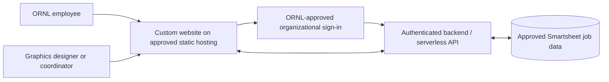

# Custom portal proposal and access model

The proposal adds a custom website while retaining Smartsheet as the job system behind it. It does not replace the existing native prototype. The working code currently offers a public synthetic demo and a local DEV adapter with separate read-only and explicitly enabled editing modes.

## Employee intake is a first-class requirement

ORNL employees outside Graphics must be able to submit a request without becoming Graphics workspace members or receiving the project sheet. The proposed production boundary is:

| Audience | Proposed identity | Proposed access |
| --- | --- | --- |
| ORNL employee / requester | ORNL-approved organizational sign-in | Submit requests and, if approved, view only their own requests and customer-visible files |
| Graphics designer | Organizational sign-in plus configured Graphics role; optional per-user Smartsheet authorization | Assigned projects and authorized project actions |
| Graphics coordinator | Explicit coordinator role | Review, offer, reassign and monitor the permitted team workspace |

Do not use a typed `@ornl.gov` address, a browser-side filter, or a preview role selector as authorization. If Entra is chosen, single-tenant access may include tenant guests; use approved employee/group membership rules as well. The identity provider, employee eligibility rule and app registration are not configured or approved by this repository.

## Recommended production shape, subject to IT review

The backend validates the user, enforces requester/designer/coordinator policies and returns only permitted fields and files. Smartsheet credentials never enter public JavaScript. Project routes use job IDs, avoiding the native shared-selector design.

Smartsheet OAuth can authorize a designer's own resource access. Employees who only submit intake should not need personal Smartsheet API access. A separately approved integration identity may write those requests to the selected sheet; its licensing, permitted use, minimum sharing and audit requirements must be verified. A shared credential's broad upstream access makes server-side authorization essential. Do not assume Smartsheet permissions become row-level portal permissions automatically.

Smartsheet's documented authorization-code exchange uses an app secret. The static frontend therefore needs a private integration layer for the documented flow. GitHub Pages serves the UI; it does not run that backend. Session/token storage, approved hosting and organizational authentication are still future implementation.

## Current local adapter

The development server binds to `127.0.0.1` only. An ephemeral HttpOnly, SameSite=Strict cookie guards its read endpoints, and Host/Origin checks reject foreign browser origins. This is local isolation, not ORNL sign-in. The token is entered using `getpass` and lives only in process memory.

The adapter uses configured synthetic row IDs or the existing native DEV-only filter on the approved DEV sheet. It verifies the source identity, exact filter definition and each row's DEV marker before returning a projection. New native DEV requests can therefore be discovered on refresh. API level 2 preserves complex task-category data.

Read-only mode has no enabled mutation path. Explicit DEV editing adds bounded intake, field updates, offers/responses, stages and new reference uploads. It never changes column definitions, formulas, workflow definitions or shared job selection. Each save checks that DEV automations remain disabled. The existing assignment formula owns Assigned Designer. A private SQLite ledger retains new IDs and idempotency keys; credentials remain memory-only. See [field mapping and operational limits](local-dev.md).

Writes require the local session, exact Host/Origin, an ephemeral CSRF token and a request identifier. Only whitelisted project actions are accepted. There is no arbitrary API proxy or deletion endpoint. Revision checks reject already-stale edits; they do not claim an atomic lock against simultaneous native edits.
File links in the local app point to a verified-job endpoint. It verifies the attachment inventory, obtains a fresh temporary URL and retrieves the file without forwarding Smartsheet credentials to storage. Only safe raster/text MIME types are previewed inline; other formats download. No expiring signed URL is persisted as a permanent link.

## Remaining implementation gates

1. Confirm ORNL identity provider, employee eligibility and Graphics role membership.
2. Register the approved apps and select backend hosting / secure credential storage.
3. Verify employee intake with a non-Graphics account and a user without a Smartsheet account.
4. Extend the tested local DEV submission/write path to an approved hosted backend, with real role authorization, durable idempotency and audit storage.
5. Test true authenticated multi-user isolation, attachment access, unauthorized IDs and concurrent edits.
6. Qualify AI, email, routing, SCOUT and Dropbox independently; none is enabled here.

Primary references checked November 17, 2026:

- [Smartsheet OAuth](https://developers.smartsheet.com/api/smartsheet/guides/advanced-topics/oauth)
- [Smartsheet access levels](https://developers.smartsheet.com/api/smartsheet/guides/basics/resource-access-levels)
- [Form access and login](https://help.smartsheet.com/articles/2482754-FAQ-Smartsheet-Forms)
- [Attachment temporary URLs](https://developers.smartsheet.com/api/smartsheet/openapi/attachments/attachments-get)
- [Microsoft supported account types](https://learn.microsoft.com/en-us/security/zero-trust/develop/identity-supported-account-types)
- [GitHub Pages deployment](https://docs.github.com/en/pages/getting-started-with-github-pages/configuring-a-publishing-source-for-your-github-pages-site)
