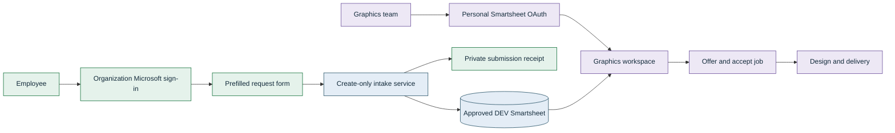

# Microsoft employee intake

Status: implemented for local qualification; **disabled in the running pilot pending IT app registration and an approved intake integration connection**. It is independent of AI Stage 1. No Smartsheet AI license is required for this sign-in feature.

## Experience and data flow

Employees open `/request`, sign in with the organization's Microsoft account and complete a form. They do not need a Smartsheet account. Name and contact email come from Microsoft Graph; department is prefilled and editable. The form preserves the description, deliverables, audience, specifications, links and additional notes. The backend creates a New DEV request and adds reference files to that row. The receipt shows the generated job number, original title and requester-uploaded filenames, with no link into the sheet. References added later by the Graphics team are not exposed in the employee receipt.

Designers and coordinators continue to use their own Smartsheet OAuth sessions. Coordinators see new DEV requests in the existing project list and can offer them to a designer. Acceptance and subsequent work stay in that workspace. The employee integration credential is never used as a fallback for a designer's failed authorization.



## Microsoft registration IT must supply

Create a **single-tenant confidential Web application** in the organization's Microsoft Entra tenant. This is separate from the existing Smartsheet developer application and from Microsoft Dev Tunnels.

| Setting | Value |
| --- | --- |
| Suggested app name | ORNL Creative Services DEV Intake |
| Supported account types | Accounts in this organizational directory only |
| Web redirect URI | The exact HTTPS pilot origin plus `/auth/microsoft/callback` |
| Delegated Microsoft Graph permission | `User.Read` |
| Sign-in flow | Authorization code, MSAL with PKCE and nonce/state validation |
| Implicit grants, device code, public client flow | Not needed |
| Refresh/offline scope | Excluded by the app |
| Mail, calendar, directory-wide read permissions | Not requested |
| Secret delivery | Enter locally at the launcher's hidden prompt; use an IT-approved secret store for deployed hosting |

The adapter calls only `GET /v1.0/me?$select=id,displayName,mail,department,userType`. It matches token `tid` to the configured tenant and Graph `id` to the token's immutable `oid`, and rejects Guest accounts. **Member status alone does not establish employment.** IT should decide whether tenant membership is sufficient or restrict eligibility to its employee group via enterprise app assignment and/or an app role. To require a token role, define and assign an application role such as `Employee.Intake` and configure `requiredRole` to that exact value. Test both eligible and ineligible identities. Do not authorize by a typed email or UPN domain.

`mail` must be populated in the directory profile. If it is missing, intake refuses sign-in and asks for a directory correction; it does not substitute a potentially non-deliverable sign-in UPN. Microsoft Graph/profile failure or missing eligibility data fails closed. Directory eligibility is evaluated at sign-in; local sessions last at most one hour (or ID token/pilot expiry, whichever comes first), with a 30-minute idle limit. Changes made after sign-in take effect on the next authentication, not through continuous directory polling.

## Smartsheet integration IT/owner must approve

Use a separately approved Smartsheet integration identity with edit access to the **existing approved DEV sheet only**. Pin its immutable user ID as `integrationUserId`. Supply its token at the hidden local prompt. The server verifies the token's actual account ID on startup and refuses a mismatch. Do not put it in a config file or browser.

Smartsheet's credential permissions may be broader than create-only. The portal narrows its employee-facing operations to creating requests and adding references to requests owned by that Microsoft principal. It exposes no generic Smartsheet proxy, row edits, assignment, deletion, attachment replacement, existing-job search, sheet data dump or attachment downloads through employee intake. Native direct access outside this portal remains governed separately by Smartsheet.

The same exact DEV sheet/filter validation, disabled native automation checks, schema/formula guards, workflow review expiry and global write switch still apply. No workflow is enabled or modified by this implementation. All new rows are marked DEV, prefixed `[DEV PORTAL]`, and start at New. The separate employee service shares the designer service's per-sheet process lock.

## Private configuration and launch

Keep the existing designer pilot configuration and add the following **only after** the registration and integration identity are approved. Example IDs below are fictional; use the actual values privately.

```json
{
  "microsoftIntake": {
    "enabled": true,
    "tenantId": "11111111-1111-4111-8111-111111111111",
    "clientId": "22222222-2222-4222-8222-222222222222",
    "integrationUserId": "123456789",
    "requiredRole": "Employee.Intake"
  }
}
```

Omit the object or set `enabled` to false to leave Microsoft intake unavailable. An empty `requiredRole` permits tenant Member accounts without an app-role requirement; use that only if IT approves this eligibility policy. Registration/source/identity changes require a restart. Disabling the feature invalidates access on the next request.

Use Python 3.12 with OpenSSL for the pilot environment and install `requirements-pilot.txt`. The older laptop environment based on macOS system Python 3.9 is sufficient for synthetic tests but should be replaced with the supported Python runtime before live MSAL qualification. Do not modify a running process's interpreter environment in place; prepare the replacement environment and switch launchers during a controlled restart.

Run `./start-pilot.command`. When the feature is configured, the launcher asks for:

1. Existing Smartsheet OAuth application secret for designers.
2. New Microsoft intake application secret.
3. Approved intake integration Smartsheet token.

All three remain in process memory. Restarting signs out both types of sessions. Preserve the existing private SQLite state and config. No credentials are written there. The new additive receipt table binds a random receipt to the Microsoft tenant/object ID, source sheet, operation key and generated job. A separate audit table records identity, action, receipt and outcome, not full request text or tokens. Protect and back up this state under the same private-state policy as the pilot.

The Microsoft Dev Tunnels organization gate remains enabled; it is not used as a trusted identity header. For eventual internal hosting, use the new domain's exact callback, HTTPS, same-origin frontend/API routing and private secret storage. Do not tunnel the older shared-token local editor.

## Endpoints and constraints

| Endpoint | Authorization / behavior |
| --- | --- |
| `GET /auth/microsoft/login` | Creates a bounded 10-minute, browser-bound flow |
| `GET /auth/microsoft/callback` | Completes MSAL verification and creates an opaque secure requester cookie |
| `GET /request` | Microsoft requester session; serves the employee form |
| `GET /api/intake/session` | Requester's own contact profile, task options, CSRF and current submission availability |
| `POST /api/intake/requests` | Same origin + requester CSRF; own verified identity, validated form fields, required idempotency key |
| `GET /api/intake/requests/{receipt}` | Only that Microsoft principal's submission confirmation, no full job payload |
| `POST /api/intake/requests/{receipt}/attachments` | Same origin + CSRF + owned receipt + current revision + idempotency key |
| `POST /auth/microsoft/logout` | Ends only the local requester session; does not sign out the user's Microsoft account globally |

Secure, HttpOnly, SameSite=Lax requester and sign-in cookies are distinct from the designer cookies. Neither session type grants the other's API access. No bearer/agent/MCP access is added in this stage.

Limits: 20 new attempts per Microsoft principal per sheet per day; up to 10 reference files per request, each at most 30 MB, restricted to PNG/JPEG/WebP/PDF/plain text. Uploads close after one day or after the request leaves New. Server-side quotas count reserved attempts too. Unknown write outcomes retain the operation receipt and are never blindly reissued; an owner must reconcile a pending operation before allowing a replacement. The UI retains the same operation keys across retries and does not recreate a saved request when an attachment upload fails. Reloading the form loses its in-memory retry state: preserve the confirmation and resolve an uncertain submission before starting a new one.

## Activation checks still required

1. IT supplies the registered application's client ID, approved eligibility policy and secret, and resolves any tenant consent restrictions.
2. Owner approves the dedicated integration account/token and pins its ID privately.
3. Prepare a supported Python/OpenSSL runtime, update private config, review native workflows again if the 24-hour review has expired, and restart the pilot with local secret entry.
4. Verify a real employee without Smartsheet access can authenticate, receives correct name/mail/department, submits one fictional request and adds a test reference.
5. Verify the generated job and reference on the actual DEV source and in the coordinator workspace, then test the existing offer/accept flow with a real designer.
6. Verify rejected Guest/wrong-tenant/ineligible identities, independent sign-outs and a second person's real sign-in.
7. Decide separately what to do with any publicly reachable **native Smartsheet form**. It remains unchanged and may still provide a separate intake path; Microsoft protection applies only to this custom portal route. Do not claim all intake is Microsoft-protected until this is addressed.

The implementation does not change native dashboards, reports, forms, formula definitions, workflows or sharing. It does not enable email, AI, SCOUT, Dropbox or production writes.

## References

- [Microsoft: acquire tokens with MSAL Python](https://learn.microsoft.com/en-us/entra/msal/python/getting-started/acquiring-tokens)
- [MSAL Python API: code flow and exclude_scopes](https://msal-python.readthedocs.io/en/latest/)
- [Microsoft Graph: get the signed-in user](https://learn.microsoft.com/en-us/graph/api/user-get?view=graph-rest-1.0)
- [Microsoft: ID token claims and identity](https://learn.microsoft.com/en-us/entra/identity-platform/id-token-claims-reference)
- [Microsoft: single-tenant apps include directory guests](https://learn.microsoft.com/en-us/entra/identity-platform/single-and-multi-tenant-apps)
